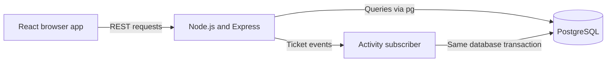

# Relay Helpdesk

Relay is a mini support desk built with Node.js, Express, PostgreSQL and React. Requesters submit and track their own tickets. Administrators work from a shared queue and reply in the same conversation.

[Live application](https://relay-helpdesk-9noe.onrender.com/) · [API health check](https://relay-helpdesk-9noe.onrender.com/api/health) · [REST API reference](docs/API.md) · [Database design](docs/DATABASE.md)

## Features

- **Requester workspace** — Register, sign in, submit tickets, comment, and track replies and status changes. Requesters can edit or withdraw their own open tickets.
- **Administrator queue** — View tickets across users, filter by status and priority, reply, and update ticket status and priority.
- **Search and pagination** — Search by title, description, or reference such as `RL-42`. Sort by recently updated, newest first, or oldest first.
- **Dashboard counts** — See total, open, in-progress, and resolved ticket counts for the current role.
- **Ticket timeline** — See who submitted, updated, commented on, or resolved a ticket, including the previous and new status for each transition.

## Technology stack

| Layer | Tools | Responsibility |
| --- | --- | --- |
| Frontend | React, Vite, CSS | Authentication screens, ticket dashboards, and detail views |
| API | Node.js, Express 5, Zod | REST routes, validation, access control, and error handling |
| Database | PostgreSQL 17, `pg` | Persistent records, relationships, and transactions |
| Authentication | JSON Web Tokens, Node.js `scrypt` | Cookie-based sessions and password hashing |
| Testing and hosting | Node.js test runner, Supertest, PGlite, GitHub Actions, Render | Integration tests, CI builds, and live deployment |

## Run locally

Prerequisites are Node.js 22.12 or later, npm, and PostgreSQL 17. Docker Compose can start PostgreSQL for you.

```bash
git clone https://github.com/Prashant1014524/relay-helpdesk.git
cd relay-helpdesk
npm ci
docker compose up -d --wait db
```

Copy `.env.example` to `.env`. The example database URL matches the Compose service. If you already have PostgreSQL, skip the Compose command, create an empty database, and use its connection URL. Generate a JWT secret and paste the result into `JWT_SECRET`.

```bash
node -e "console.log(require('node:crypto').randomBytes(32).toString('hex'))"
npm run dev
```

Open [http://127.0.0.1:5173](http://127.0.0.1:5173). Express starts on port 3000 and applies the SQL schema at startup. Vite proxies `/api` to Express. If you change the API port, update the proxy target in `vite.config.js`.

For an administrator account, add `ADMIN_EMAIL` and `ADMIN_PASSWORD` to `.env` using a new email and a unique password of at least 10 characters. Run `npm run admin:set`. Once the account exists, remove both bootstrap values from `.env`. Sign in with those credentials while using a separate requester account to submit tickets.

```bash
npm test
npm run build
npm start
```

After building, Express serves the frontend and API at [http://localhost:3000](http://localhost:3000). For local HTTP, leave `NODE_ENV` unset so the browser can accept the development session cookie.

### Environment variables

| Variable | Purpose |
| --- | --- |
| `DATABASE_URL` | PostgreSQL connection URL. Required. |
| `JWT_SECRET` | Session signing secret of at least 32 bytes. Required. |
| `PORT` | API listening port. Defaults to `3000`. |
| `NODE_ENV` | Set to `production` when serving over HTTPS to enable secure session cookies. |
| `TRUST_PROXY_HOPS` | Number of trusted proxy hops. Defaults to `0`. The Render Blueprint sets `1`. |
| `ADMIN_EMAIL`, `ADMIN_PASSWORD` | Optional bootstrap credentials. Set both to create the administrator account. |

## Architecture



| Path | Responsibility |
| --- | --- |
| [client/](client/) | React screens, styles, and HTTP client |
| [server/app.js](server/app.js) | Express middleware, health endpoint, frontend hosting, and error handling |
| [server/auth.js](server/auth.js) | Registration, sign-in, session validation, and sign-out |
| [server/tickets.js](server/tickets.js) | Ticket routes, filters, access rules, and ticket changes |
| [server/events.js](server/events.js) | Event dispatch and activity persistence |
| [server/schema.sql](server/schema.sql) | PostgreSQL tables, relationships, constraints, and indexes |
| [shared/options.js](shared/options.js) | Shared status, priority, category, and activity labels |
| [test/helpdesk.test.js](test/helpdesk.test.js) | HTTP integration tests |

## Ticket rules

| Action | Requester | Administrator |
| --- | --- | --- |
| Submit a ticket | Yes | Use a requester account |
| View, filter or comment | Own tickets | All visible tickets |
| Edit the title, description or category | Own open tickets | — |
| Change priority | Own open tickets | Any visible ticket |
| Change status | — | Any visible ticket |
| Withdraw a ticket | Own open tickets | — |

Tickets start open. Administrators can change status to open, in progress, resolved, or closed, including reopening a ticket. Commenting remains available at every status. Withdrawal hides the ticket from the application and preserves its history in PostgreSQL.

Categories are **Account**, **Billing**, **Technical**, and **General**. Priorities are **Low**, **Medium**, **High**, and **Urgent**.

## Event handling

Ticket routes publish events inside the transaction that changes the ticket. The activity subscriber uses the same database connection and transaction to insert the history row. If that insert fails, the ticket change rolls back. A row lock serializes concurrent writes to the same ticket.

| Event | Trigger and recorded details |
| --- | --- |
| `ticket_created` | A requester submits a ticket. |
| `ticket_updated` | A field other than status changes. The log records which fields changed. |
| `status_changed` | An administrator changes status. The log records the previous and new values. |
| `comment_added` | A requester or administrator posts a comment. The log records the comment ID. |
| `ticket_resolved` | A ticket moves into Resolved. This event accompanies the status change. |
| `ticket_deleted` | A requester withdraws an open ticket. The event remains in the database for audit. |

Each row stores the ticket, actor, and timestamp. Saving the current status and priority again creates no duplicate events.

## Data model and security

- Express routes validate input with Zod, then apply the role and ownership rules before running parameterized queries through `pg`.
- Public registration creates requester accounts. Server-side bootstrap provisions administrators. Passwords use salted scrypt hashes and authentication routes have an IP-based rate limit.
- The API issues one-hour HS256 JWTs in HttpOnly, SameSite=Strict cookies. Production cookies also use Secure. Each protected request reads the current account and role from PostgreSQL. Signing out clears the browser cookie. A previously copied token remains valid until expiry.
- A user can own many tickets. Each ticket can have multiple comments and activity entries. Foreign keys connect those records to the ticket and the user who authored or performed each action.
- Partial indexes support active ticket lists and common filters. Lists use offset pagination. Search uses case-insensitive substring matching, which may benefit from full-text or trigram indexes as the queue grows.
- Requests for another user's ticket return `404`. The API limits JSON body size and returns a generic response for unexpected server errors.

## API overview

| Endpoint | Purpose |
| --- | --- |
| `GET /api/health` | Check API availability and database connectivity |
| `POST /api/auth/register`, `POST /api/auth/login` | Create a requester account or start a session |
| `GET /api/auth/me`, `POST /api/auth/logout` | Read the current account or clear the session |
| `GET /api/tickets`, `GET /api/tickets/stats` | List visible tickets and get role-scoped counts |
| `POST /api/tickets` | Submit a support request |
| `GET /api/tickets/:id` | Read a ticket, its conversation, and its history |
| `PATCH /api/tickets/:id`, `DELETE /api/tickets/:id` | Update or withdraw a ticket according to the caller's role |
| `POST /api/tickets/:id/comments` | Add a comment to a visible ticket |

Login and registration return a session cookie. Browsers send it on same-origin requests. API clients can keep it in a cookie jar. [Request formats, cURL examples, and response codes](docs/API.md)

## Testing

Run `npm test` to verify session cookies, role and ownership restrictions, administrator replies and resolution, queue filters, and transaction rollback when activity persistence fails. The tests use an in-memory PostgreSQL engine and run without Docker or a database connection string. [GitHub Actions checks](https://github.com/Prashant1014524/relay-helpdesk/actions)

## Deploy to Render

1. Push the repository to GitHub. In Render, create a Blueprint using that repository. Authorize Render to access the repository if prompted.
2. Deploy the Blueprint. The included `render.yaml` provisions a Node web service and a PostgreSQL 17 database. The build compiles React, and Express serves the frontend and API on the same origin. Render generates the JWT secret and the initial password for `admin@relay.example`. The workspace owner can retrieve `ADMIN_PASSWORD` from the web service's Environment page after deployment.
3. After the first successful deploy, open the web service's URL and check `/api/health`. Register a requester, submit a ticket, and use a separate admin session to reply and resolve it.
4. Share the live URL and provide any evaluator credentials through a private channel. An existing administrator keeps its original password when the bootstrap values change.

The Blueprint uses Render's free plans. Account for free database expiration if the evaluator will review the project later. [Render Blueprint reference](https://render.com/docs/blueprint-spec) · [Free plan limits](https://render.com/docs/free)
